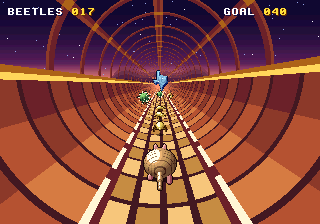
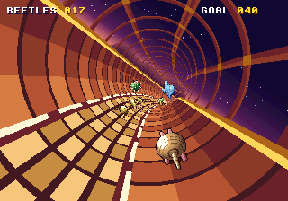
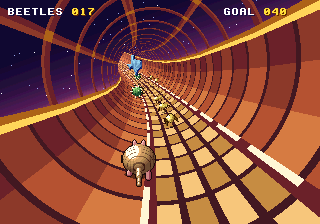
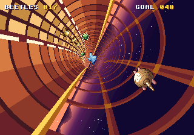
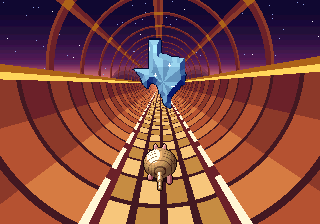
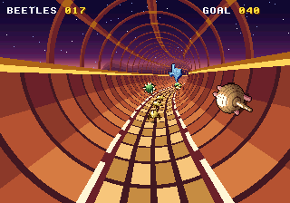
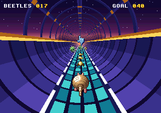
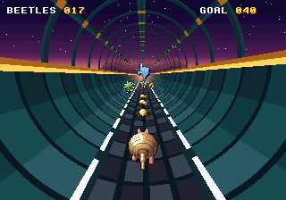

# Exact Armadillo Run

An armadillo races down a desert half-pipe at dusk, collecting spinning golden beetles and
rolling up to jump the thorn balls. Above the rims the pipe goes on as an open frame of ribs, so it can run all the way round, upside down, with the camera rolling after it. It is one bonus stage in the style of the early-90s
half-pipe stages, drawn on [`engines/sys16`](../../engines/sys16) (a System 16-style board)
with sound from [`engines/ym2612`](../../engines/ym2612).










*Straight · round a bend · over a rise · overhead · the gem · the fixed camera · turquoise · midnight*

## Run it

From the repo root:

```sh
bun run armadillo          # build and open it
bun run test:armadillo     # its tests
```

Or from this folder: `bun exact.mjs mac --run`, and `bun exact.mjs test macos`.

## Play

| Key | Action |
| --- | --- |
| Left, Right (or A, D) | Run round the pipe: up either wall, over the top, all the way round |
| Space, Up (or W, Z) | Roll up into a ball and jump |
| Up, Down, Left, Right on the title | Choose the camera (FOLLOW or FIXED) and the track's colours (DUSK, TURQUOISE or MIDNIGHT) |
| Space or Enter | Start, or play again |

The stage has three stretches. The first two end at checkpoints (a pink and white stripe
across the pipe) that want a running total of beetles: 40, then 80. The last ends at a giant
blue topaz in the shape of Texas, floating in the pipe. Reach it with 120 beetles and it is
yours, with a fanfare; without them, it rises out of the pipe and away. A thorn ball knocks 10
beetles out of you; jump it. A short fanfare plays before each run.

There are two cameras. **Follow** rolls round the pipe after you, so the whole world turns
as you run up the walls and over the top. **Fixed** stays put, as the old half-pipe stages
did, and only the armadillo moves. Everything else is the same. With a fixed camera, the
armadillo leaves the top of the screen when it is high on the frame overhead.

## How it's made

- **The pipe** is sys16's tube layer. Out Run's road chip was a layer behind the sprites,
  drawn line by line from tables the CPU rewrote every frame. The tube keeps that split:
  every frame the contract sends the course ahead (the pipe's curve and climb at each 8 units),
  and the GPU module adds them up into the axis's offsets, as the road CPU did. The layer then
  finds the true point of the pipe behind every pixel: its distance and its angle round the
  pipe. Nothing is a pre-drawn tube frame. The camera rolls round the pipe after the
  armadillo, and the sky behind the frame overhead turns with it: sys16 can turn its
  backdrop and back layers about a point, as Sega's Y Board turned its whole screen. Walls curve as walls do, bends hide what is round
  them, and the skin scrolls at the true speed for its distance.
- **The sprites** are real scaler sprites. Each beetle, thorn ball and the armadillo is one
  piece of 4-bit art, zoomed to its exact size for its distance every frame, a whole source
  pixel at a time. There are no pre-shrunk size steps. The art (eight spin frames for a
  beetle, four stride frames and a rolled ball for the armadillo, a tilt for each 20° of
  wall) is rendered once at start-up from small solid models, in `gpu/src/art.rs`.
- **The sound** is an emulated YM2612. "Beetle Rush" (G major, six channels with DAC drums)
  and six effects are register writes in `gpu/src/music.rs`, rendered to WAV ahead of time:
  `cargo test --release -p exact-armadillo-run-gpu render -- --ignored`.
- **The rules** are in `app.contract` and `course.contract`: the course's slots and
  patterns, the steering, the jump, the checkpoints.
