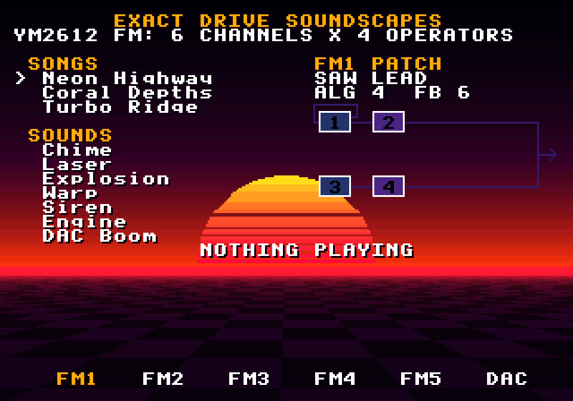
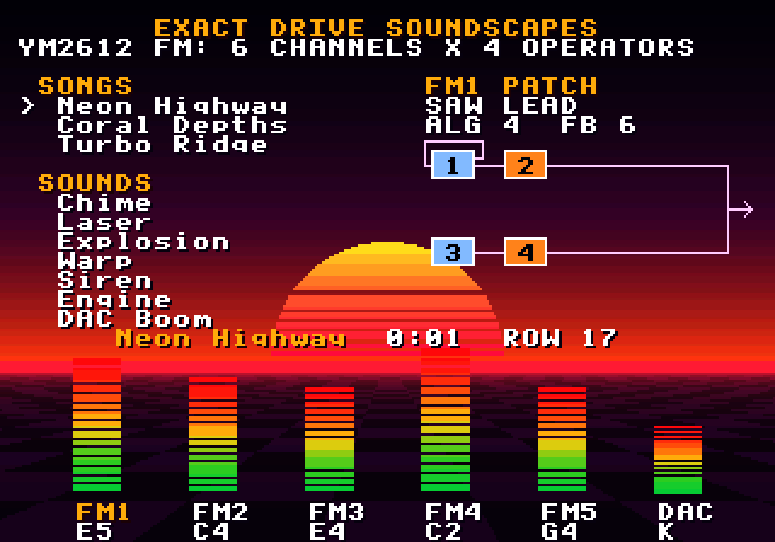

# Exact Drive Soundscapes

A jukebox for the [`ym2612`](../../engines/ym2612) engine: three original songs and seven sound
effects, each made by the emulated Mega Drive FM chip, on a dusk screen drawn by the
[`sys16`](../../engines/sys16) picture engine at 320×224. While a song plays, six meters follow
each channel's level, and the watched channel's patch shows its algorithm: which of its four
operators modulate which, lit as it sounds.




*Waiting · Neon Highway playing, FM1's patch lit*

## Run it

From the repo root:

```sh
bun run soundscapes          # build and open it
bun run test:soundscapes     # its tests
```

Or from this folder: `bun exact.mjs mac --run`, and `bun exact.mjs test macos`. See the
[root README](../../README.md) for what a build needs.

## Controls

| Key | Action |
| --- | --- |
| Up / Down | Choose a song or a sound |
| Z, Space or Enter | Play it |
| X or Escape | Stop the song |
| Left / Right | Choose the FM channel whose patch is shown |

## The music

| Song | Style |
| --- | --- |
| Neon Highway | A driving synthwave run in E minor at 150 BPM: a saw lead with vibrato, an electric-piano arpeggio, a pad on the LFO, an octave-jumping bass, DAC drums |
| Coral Depths | A slow, open piece in D at 112 BPM: a glass bell melody, dotted electric-piano chords, a pad, a round sub bass, soft claps |
| Turbo Ridge | A fast A-minor chase at 180 BPM: an overdriven lead, brass stabs, palm-muted guitar chugs, a riffing bass |

Channels 1–5 are FM; channel 6 is the DAC, playing drum samples. Panning spreads the parts
across left and right. The patches (`gpu/src/music.rs`): Drive Bass, Saw Lead, E.Piano, Glass
Bell, Dusk Pad, Sub Bass, Overdrive, Brass Stab, Chug Guitar.

The sound effects are register writes, frame by frame, each showing a part of the chip:
**Chime** (the bell patch, two notes), **Laser** (one operator in full feedback, its pitch
thrown down), **Explosion** (four chained operators and deep feedback: FM noise),
**Warp** (channel 3's special mode, four pitches climbing apart), **Siren** (the LFO's deepest
vibrato), **Engine** (SSG-EG repeating a fast decay), **DAC Boom** (a sample through the DAC).

## How it's made

- `gpu/src/music.rs`: the patches, songs (tracker text for ym2612's driver) and sound effects
  (register scripts).
- `gpu/src/lib.rs`: the screen for sys16, shown by [`nes-screen`](../../engines/nes-screen): a
  sky gradient, a scrolling perspective floor, a banded sun that swells on the beat, the
  algorithm diagrams (drawn for all eight algorithms), the meters (zoomed sprites) and text.
  Its `render` test makes the audio: `cargo test --release -p exact-drive-soundscapes-gpu render
  -- --ignored` renders each song (two passes, for a seamless loop) and effect to
  `assets/music/` and `assets/sfx/`, and writes `songs.contract`: each song's notes, levels and
  patches by row.
- `app.contract`: the view: the list, the keys, the song's `audio` (looping), each effect's
  `playSound`, and the screen's inputs, found from the time a song has played.

Exact plays declared audio files rather than samples made live, so the chip renders ahead of
time; the sound is the chip's all the same.

The tests are in `app.test.contract` (4 of them); each builds the macOS app and drives it.
`CLAUDE.md` has notes for working on it with Claude Code.
