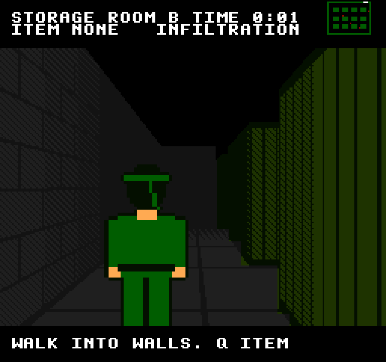
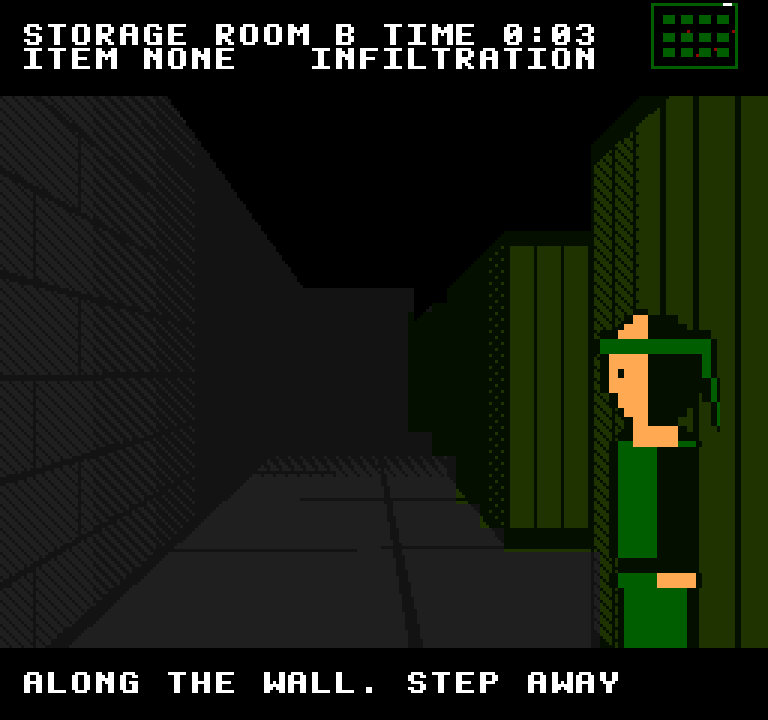
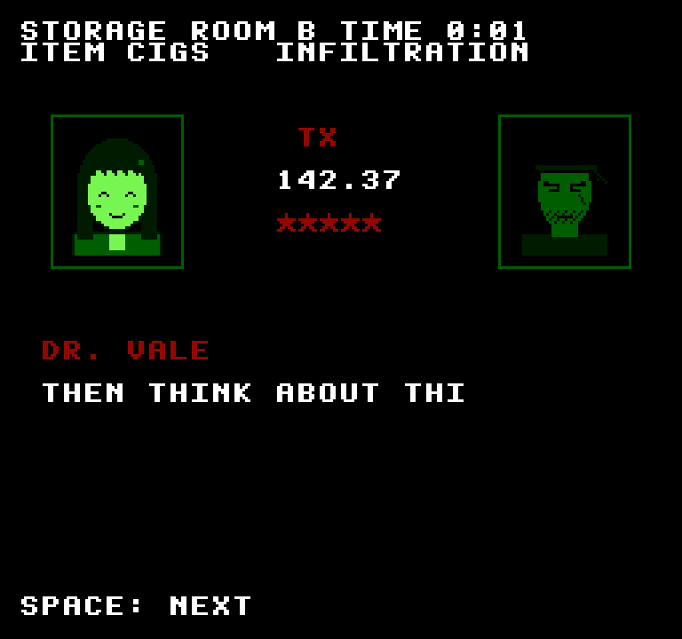

# Exact Gear Solid NES

[Exact Gear Solid](../exact-gear-solid/README.md)'s storage room, remade for the NES engines: the
same four guards on the same patrols, the same sight rules and the same wall-pressing, seen in 3D
from behind your shoulder, drawn by the NES picture processor and scored by the NES sound chip.







*Behind you · back to a wall · round the corner · the radio · spotted*

## Run it

From the repo root:

```sh
bun run gear-nes          # build and open it
bun run test:gear-nes     # its tests
```

Or from this folder: `bun exact.mjs mac --run`, and `bun exact.mjs test macos`. See the
[root README](../../README.md) for what a build needs.

## Controls

| Key | Action |
| --- | --- |
| Up / Down | Walk forward, back away |
| Left / Right | Turn (letting go squares you to the nearest eighth of a circle) |
| Walk into a wall | After a quarter second, press your back to it: the camera cuts to look along it, you in profile |
| On a wall: Up / Down | Slide along it; at its end, keep going to lean round the corner |
| On a wall: the side away from it | Step off |
| Q | The next item: none, cigarettes, the cardboard box |
| Space | Go on in a radio call; try again, or play again |

Reach the exit, green in the north wall (the white mark at the top of the minimap). The minimap,
top right, is a pixel a metre: the guards are red dots, you the white one. A guard sees 6 m ahead,
30° either side, unless a container is in the way; a **?** over a guard and CAUTION mean you're
half-seen, and about 0.7 s in its view spots you. Leaning round a corner, the wall hides you until a
guard is near its edge. In the box, a guard notices you only if you move while it watches.

Light up and the radio rings: Dr. Vale, on 142.37, has things to say about what smoke does to
you (cut down from the original's call to fit an NES screen). After that, you smoke.

## The music

"Infiltration", by the NES sound chip ([`engines/nes-apu`](../../engines/nes-apu)): slow and
tense, E Phrygian at about 90 beats a minute. A triangle heartbeat, a thin 12.5% pulse turning
over E, B and the flat second, soft noise ticks, and a sparse lead with a slow vibrato that waits
two bars to come in. The sound effects are the chip's too: the alert sting, the radio's ring, the
box's rustle, and a call for a mission complete.

## How it's made

- `room.contract`: the original game's rules, unchanged: the room, the routes, sight.
- `calls.contract`: Dr. Vale's call, shortened for the NES.
- `app.contract`: walking and turning, pressing to walls, sliding, peeking (the original's), the
  items and the radio, and what the picture is told.
- `gpu/src/lib.rs`, drawn by [`nes-ppu`](../../engines/nes-ppu) and shown by
  [`nes-screen`](../../engines/nes-screen):
  - the 3D view: a ray caster draws the room from a camera behind you (pulled in when a wall is
    close), or along the wall you're pressed to, then cuts it into tiles and picks each 8×8 cell's
    palette, as a CHR-RAM game would; the guards and you are sprites scaled to their distance and
    cut where a nearer wall hides them;
  - the minimap, a pixel a metre, made as tiles each frame;
  - the radio: codec frames with Dr. Vale (upset, then smiling) and you, drawn as tiles.

  It breaks NES rules freely: new tiles every frame, scaled sprites, a palette per 8×8 cell, no
  sprite limits (`Limits::MODERN`).
- `gpu/src/music.rs`: the song (tracker text) and the sound effects (register writes).
  `cargo test --release -p exact-gear-solid-nes-gpu render -- --ignored` renders them to
  `assets/music/` and `assets/sfx/`.

The tests are in `app.test.contract` (7 of them); each builds the macOS app and drives it.
`CLAUDE.md` has notes for working on it with Claude Code.
