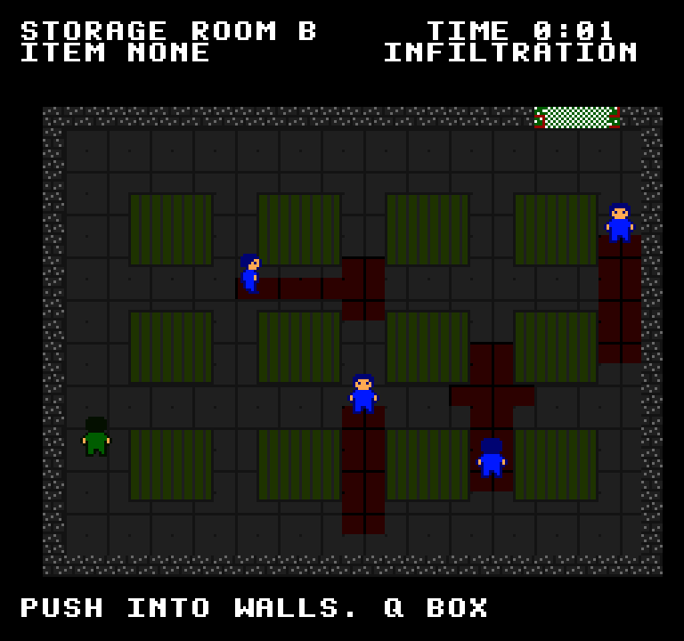
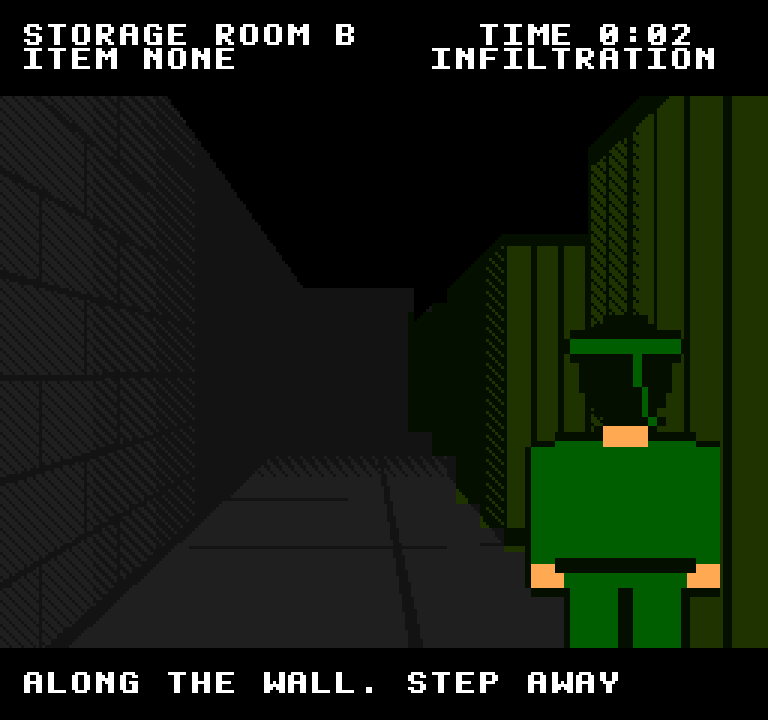
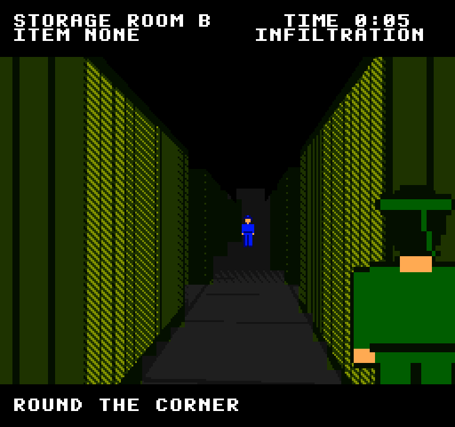
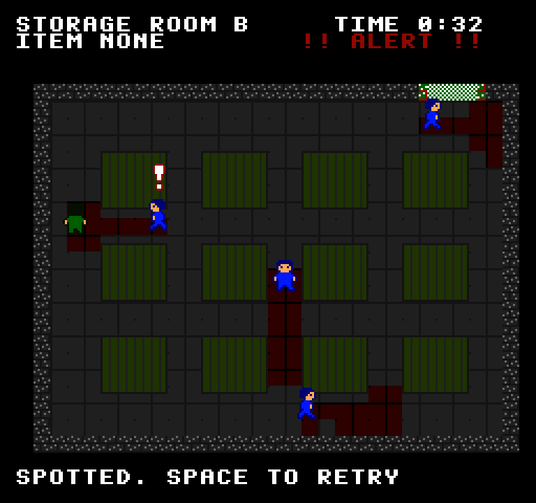

# Exact Gear Solid NES

[Exact Gear Solid](../exact-gear-solid/README.md)'s storage room, remade for the NES engines: the
same four guards on the same patrols, the same sight rules and the same wall-pressing, drawn by
the NES picture processor and scored by the NES sound chip. From above, every guard's view cone
lights the floor; press your back to a wall and the view cuts to over your shoulder, a ray-cast
corridor drawn in NES tiles.






*From above · over the shoulder · round the corner · spotted*

## Run it

From the repo root:

```sh
bun run gear-nes          # build and open it
bun run test:gear-nes     # its tests
```

Or from this folder: `bun exact.mjs mac --run`, and `bun exact.mjs test macos`. See the
[root README](../../README.md) for what a build needs.

## Controls

| Key | Action |
| --- | --- |
| Arrows or WASD | Move (hold two keys to move diagonally) |
| Push into a wall | After a quarter second, press your back to it: the view cuts over your shoulder |
| Along the wall | Slide; at its end, keep going to lean round the corner |
| Away from the wall | Step off it, back to the view from above |
| Q | Get into the cardboard box, or out (a guard notices only a box that moves while it watches) |
| Space | Try again, or play again |

Reach the exit, green in the north wall at the top right. A guard sees 6 m ahead, 30° either
side, unless a container is in the way: the floor it can see is lit red. CAUTION means a guard
has half-seen you; stay in its view about 0.7 s and you are spotted. Leaning round a corner, the
wall hides you until a guard is near its edge.

## The music

"Infiltration", by the NES sound chip ([`engines/nes-apu`](../../engines/nes-apu)): slow and
tense, E Phrygian at about 90 beats a minute. A triangle heartbeat, a thin 12.5% pulse turning
over E, B and the flat second, soft noise ticks, and a sparse lead with a slow vibrato that waits
two bars to come in. The sound effects are the chip's too: the alert sting, the box's rustle,
and a call for a mission complete.

## How it's made

- `room.contract`: the original game's rules, unchanged: the room, the routes, sight.
- `app.contract`: the original's moves (walking, pressing to walls, sliding, peeking, the box,
  being seen), and what the picture is told: the view, you, the shoulder camera, the guards.
- `gpu/src/lib.rs`: both views, drawn by [`nes-ppu`](../../engines/nes-ppu) and shown by
  [`nes-screen`](../../engines/nes-screen):
  - from above, the room at 8 pixels a metre, drawn once and cut into tiles; the floor cells a
    guard can see swap to a red palette each frame;
  - over the shoulder, a ray caster draws the view each frame, cuts it into tiles and picks each
    8×8 cell's palette, as a CHR-RAM game would; the guards and your shoulder are sprites scaled
    to their distance and cut where a nearer wall hides them.

  It breaks NES rules freely: new tiles every frame, scaled sprites, a palette per 8×8 cell, no
  sprite limits (`Limits::MODERN`).
- `gpu/src/music.rs`: the song (tracker text) and the sound effects (register writes).
  `cargo test --release -p exact-gear-solid-nes-gpu render -- --ignored` renders them to
  `assets/music/` and `assets/sfx/`.

Left out from the original: the cigarettes and Dr. Vale's radio call.

The tests are in `app.test.contract` (6 of them); each builds the macOS app and drives it.
`CLAUDE.md` has notes for working on it with Claude Code.
