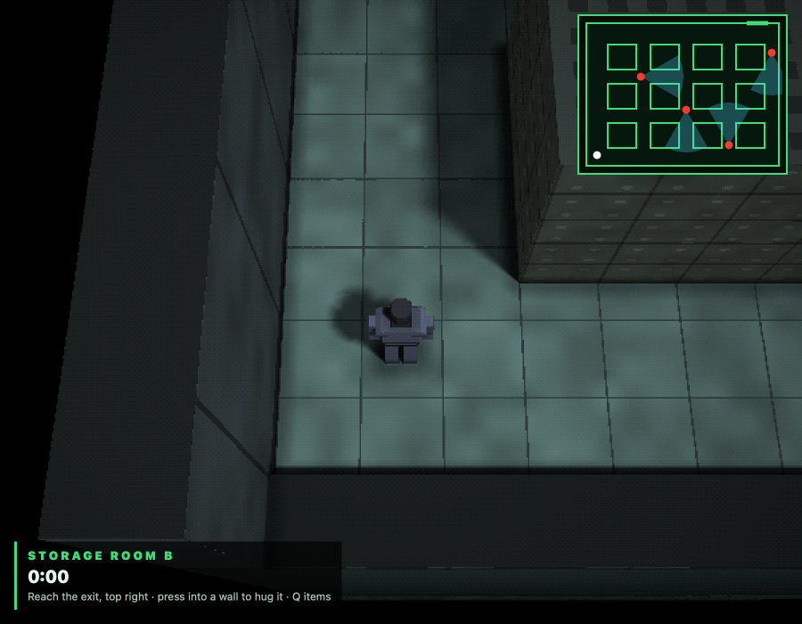
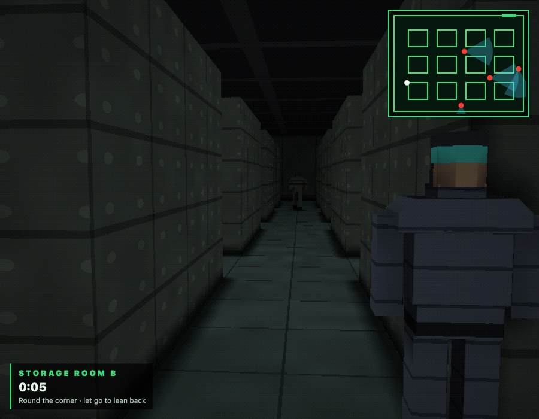
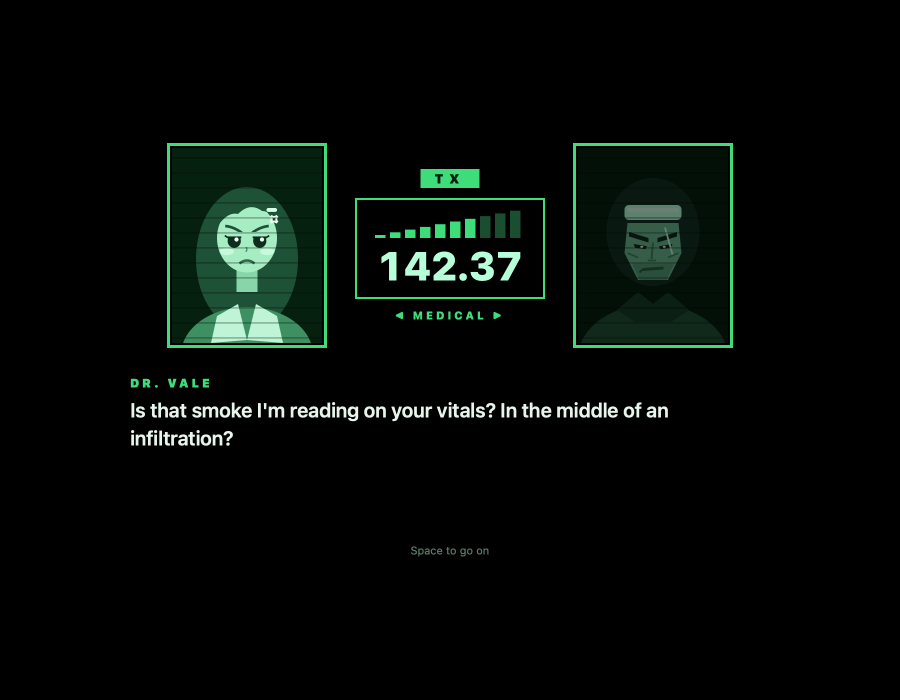

# Exact Gear Solid

A late-90s stealth game in the style of the PlayStation's tactical espionage. Cross a dim
storage room past four patrolling guards, with an overhead camera, a radar of their view cones,
a camera that drops beside you when you press your back to a wall, and a medical officer who
has opinions about your smoking.





*The overhead camera and the radar · Back to a wall, leaning round the corner · A radio call from Dr. Vale*

## Run it

From the repo root:

```sh
bun run gear          # build and open it
bun run test:gear     # its tests
```

Or from this folder: `bun exact.mjs mac --run`, and `bun exact.mjs test macos`. See the
[root README](../../README.md) for what a build needs.

## Controls

| Key | Action |
| --- | --- |
| Arrows or WASD | Move (hold two keys to move diagonally) |
| Push into a wall | After a quarter second, press your back to it; the camera drops beside you |
| Along the wall | Slide; you stop at its corner, so you can look round it |
| Away from the wall | Step off it |
| Q | Items (the game pauses): ← → to choose, Q to equip, Escape to close |
| Space | Go on in a radio call; try again, or play again |

Items: **CIGS** (light up, and your medical officer calls to scold you) and **C.BOX** (hide
inside; a guard notices only a box that moves while it watches).

Reach the exit at the top right of the radar. A guard sees 6 m ahead, 30° either side, unless
a container is in the way. A question mark means a guard has half-seen you; stay in its cone
for about 0.7 s and you are spotted. Leaning round a corner, the wall hides you until a guard is
near its edge. At each waypoint a guard stops and slowly looks both ways.

## How it's made

- `app.contract`: the view and the game: moving, pressing to walls, peeking, being seen, the items and calls.
- `room.contract`: the room: containers, walls, the guards' patrols and their view cones.
- `items.contract`: the items, and the radio call's lines and portraits.
- `gpu/shaders/room.wgsl`: the room, the guards and the player, drawn in 3D on the GPU with soft shadows.

The tests are in `app.test.contract` (10 of them); each builds the macOS app and drives it.
`CLAUDE.md` has notes for working on the game with Claude Code.
