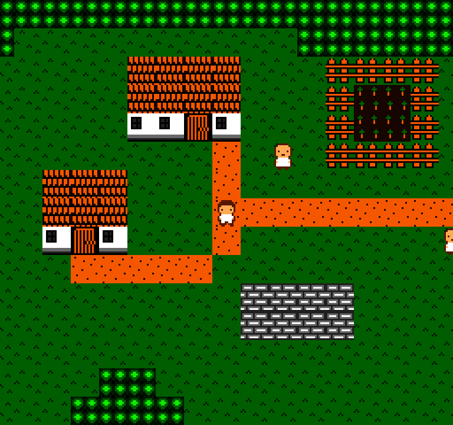
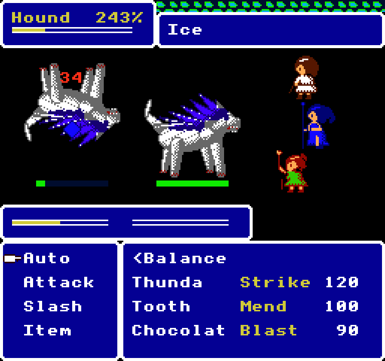
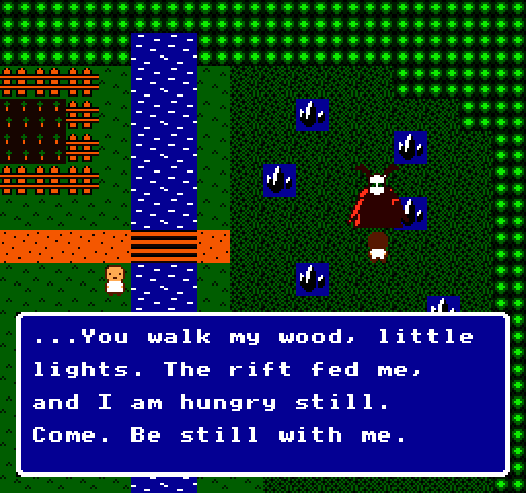
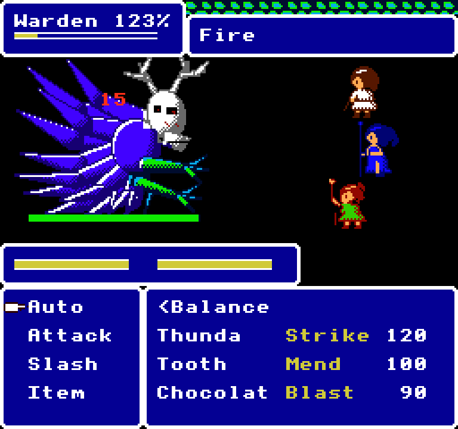

# Exact Odyssey

An 8-bit console RPG drawn on a real NES-style picture processor: 2C02 colours, 8×8 CHR
tiles, attribute palettes and 3-colour sprites. Walk Reedholm with Thunda, Tooth and Chocolat,
then fight real-time ATB battles with stagger chains, juggling and party stances, and face the
Gloamwarden in the wood.






*Reedholm · A staggered hound, launched upside down · The Gloamwarden in the thicket · The boss fight*

## Run it

From the repo root:

```sh
bun run odyssey          # build and open it
bun run test:odyssey     # its tests
```

Or from this folder: `bun exact.mjs mac --run`, and `bun exact.mjs test macos`. See the
[root README](../../README.md) for what a build needs.

## Controls

| Key | Action |
| --- | --- |
| Arrows or WASD | Walk, tile by tile |
| Space, Enter or Z | Talk; choose in battle |
| Escape or X | Back, when choosing a target |

Battles run in real time: gauges fill and enemies attack while your menu is open; only one
action plays at a time, the next right after. Each member's ATB gauge has two segments, one
ability each. You command Thunda, the leader. The chooser sits bottom left (it goes away while her commands
wait or play out), with her ATB bar above it; choose an ability and its
name appears over a segment. Choose a second, then a target (the chooser becomes a target list),
to commit both; **Auto** fills both by her role and goes straight to the target list. Committed,
the commands stay on the bar until it fills and she acts; press Space or Enter first and she acts
at once with the segments she has, dropping the rest. **Right** commits a single queued ability.
Each segment is a block: it fills, turns solid once charged, and is gone from the bar as its
command finishes. Escape takes back a slot. **Item** commits a Potion, which heals the whole
party, or a Revive, which brings a fallen ally back at half HP. Tooth
and Chocolat fill theirs by role (shown in yellow) and act. Press **Left** for the stance list, in the chooser,
free at any time, even mid-attack, where a shift cancels the party's commands; a "Stance Shift!" banner sweeps across the screen. The stances: **Assault** (all Blast), **Rush** (Strike, Strike, Blast), **Balance** and
**Bulwark**. Only Strike attacks; Blast throws Fire and Ice, which build an enemy's chain fast; Mend
cures and heals, and casts Raise by itself when an ally has fallen; Guard can Taunt and Steel. The chain drains over time, slower just after a Strike hit. The stagger panel
at the top left follows the enemy you last targeted. Each attacker leaps in beside its target, weapon out. Staggered, an enemy takes far more damage (each spell on it keeps the stagger going a little longer),
and Strike hits launch it: upside down in the air, it can't act. Each enemy's HP shows as a green bar
beneath it. A win shows your time and a 1–5 star rank (five stars finds a Potion) while the party
strikes victory poses, and the party
is healed in full after every fight.

Deep in the thicket east of the bridge waits the **Gloamwarden**, the forest's boss: walk up to
it and talk to it to start the fight. It is one huge enemy (too big to launch), and every third
turn it sweeps the whole party with Gloom Tide. Beaten, it is gone from the wood.

To write the pattern tables as PNG sheets and two sample frames to `assets/sheets/`:

```sh
cargo test -p exact-odyssey-gpu sheets -- --ignored
```

## How it's made

- `app.contract`: the view and the game: walking, talking, and the real-time battle.
- `field.contract`: Reedholm's map, the villagers, and the Gloamwarden's place in the wood.
- `battle.contract`: the party, the enemies and the boss, roles and stances, chains, staggers, ranks.
- `gpu/src/art.rs`: every tile, sprite and palette as text pixel art; `gpu/src/lib.rs`: the scene
  the view describes, drawn by [`nes-ppu`](../../engines/nes-ppu) and shown by
  [`nes-screen`](../../engines/nes-screen).
- `tools/`: the scripts that drew the enemies and the party's flourishes.

The game keeps the NES's sprite rules (8 a line, with flicker) and breaks three others by name
in `gpu/src/lib.rs` (`LIMITS`): flipped background tiles (juggled enemies), a palette per 8×8
cell (its enemies), and pattern tables over 256 tiles.

The tests are in `app.test.contract` (18 of them); each builds the macOS app and drives it.
`CLAUDE.md` has notes for working on the game with Claude Code.
