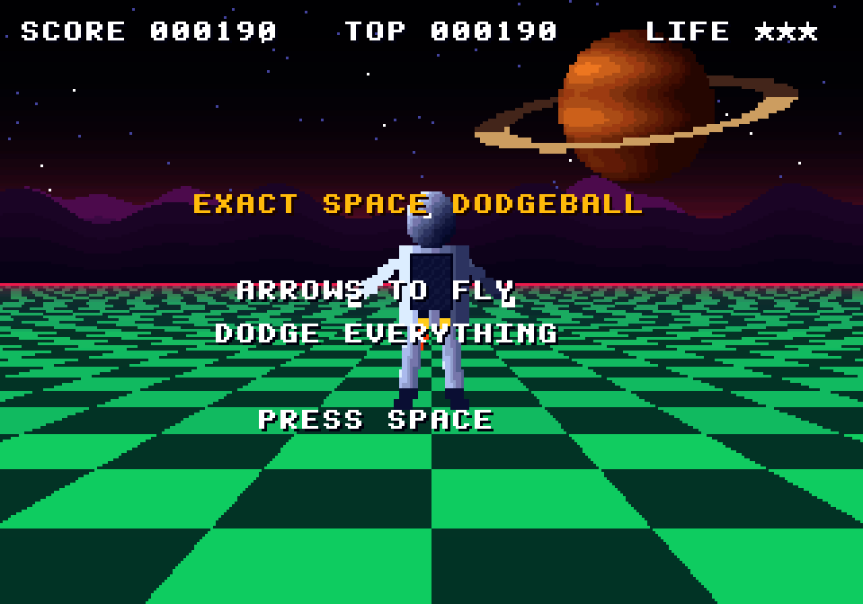
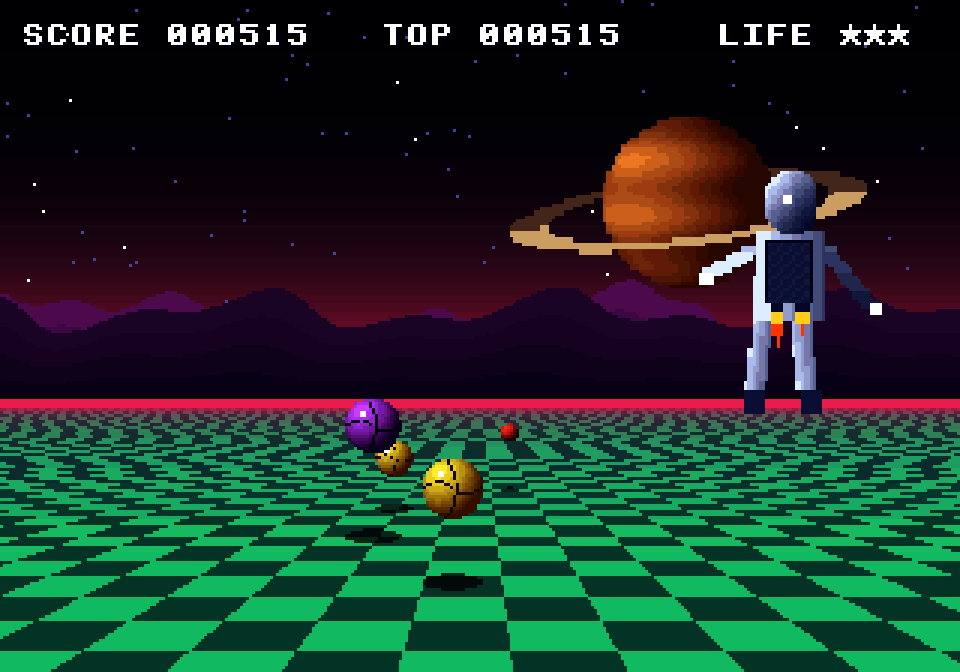
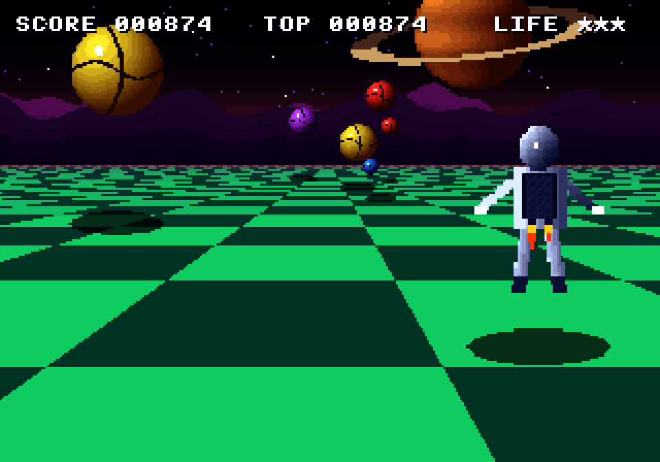

# Exact Space Dodgeball

Fly low over a checkerboard in space while giant dodgeballs bounce at you from the horizon and
stone pillars stand in your way. No shooting: just dodging. It looks like a mid-80s Sega arcade
board, drawn by [`engines/sys16`](../../engines/sys16), a Super Scaler-style picture processor:
everything that comes at you is one piece of art, zoomed from a speck to the size of the screen.





*The title · flying high · flying low*

## Run it

From the repo root:

```sh
bun run dodgeball          # build and open it
bun run test:dodgeball     # its tests
```

Or from this folder: `bun exact.mjs mac --run`, and `bun exact.mjs test macos`. See the
[root README](../../README.md) for what a build needs.

## Play

| Key | Action |
| --- | --- |
| Arrows or WASD | Fly: left, right, up, down |
| Space or Enter | Start, or play again |

Balls are thrown near where you are and bounce as they come; now and then a pillar stands in a
lane. Each passes the spot where you fly: if it is where you are, you lose a life and flash for
two seconds. You have three. The longer you last, the faster you fly and the more they throw.
Your score is the distance you fly.

## How it's made

- `field.contract`: the field's numbers: speeds, gravity and bounce, the throws (the same
  every game, from a fixed random sequence), lives.
- `app.contract`: the tick: you fly, everything comes on and bounces, what passes you hits or
  misses; the title and the game over; what the picture is told.
- `gpu/src/lib.rs`: the `s16` surface, drawn by sys16 and shown by
  [`nes-screen`](../../engines/nes-screen) at 320×224:
  - the art, all 4-bit, made in code: dodgeballs lit from the upper left with seams and a
    shine (four palettes), fluted stone pillars with gold bands, you from behind with a jet
    pack (banking, its flames flickering), a ringed planet, two mountain ranges, stars;
  - the camera rides behind you, climbs with you and tilts: flying high, the horizon sinks;
  - each frame: the sky's raster gradient, the stars and mountains scrolled by line for
    parallax, the checkerboard ground, the planet, every ball and pillar zoomed to its distance
    with a shadow under it, you, and the text.

No sound yet: these boards made their music with an FM chip, which none of this repo's engines
emulate.

The tests are in `app.test.contract` (3 of them); each builds the macOS app and drives it.
`CLAUDE.md` has notes for working on it with Claude Code.
