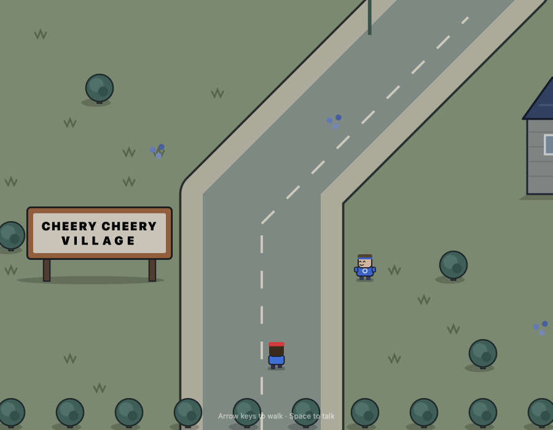
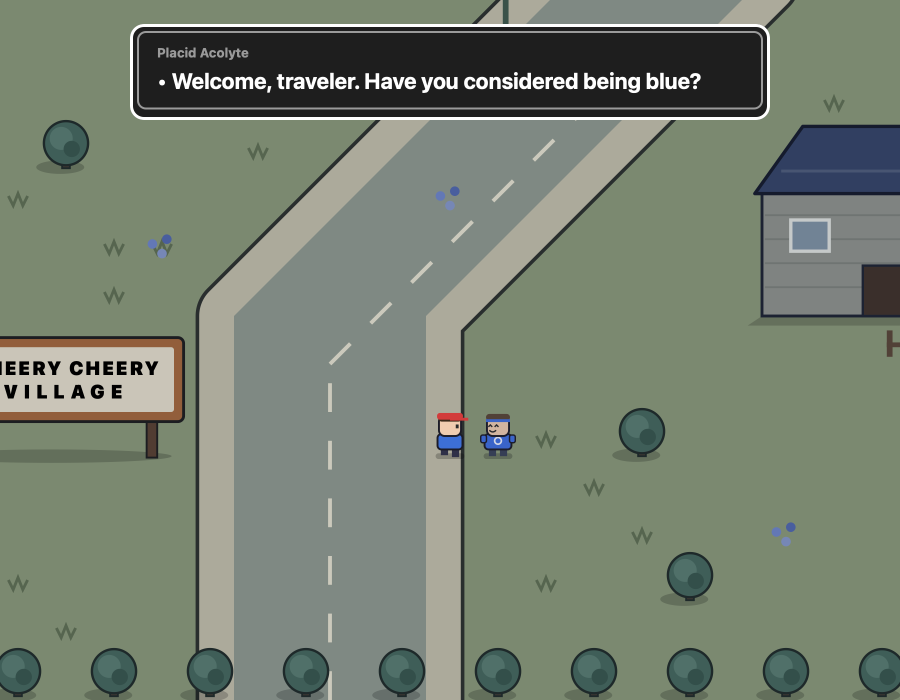
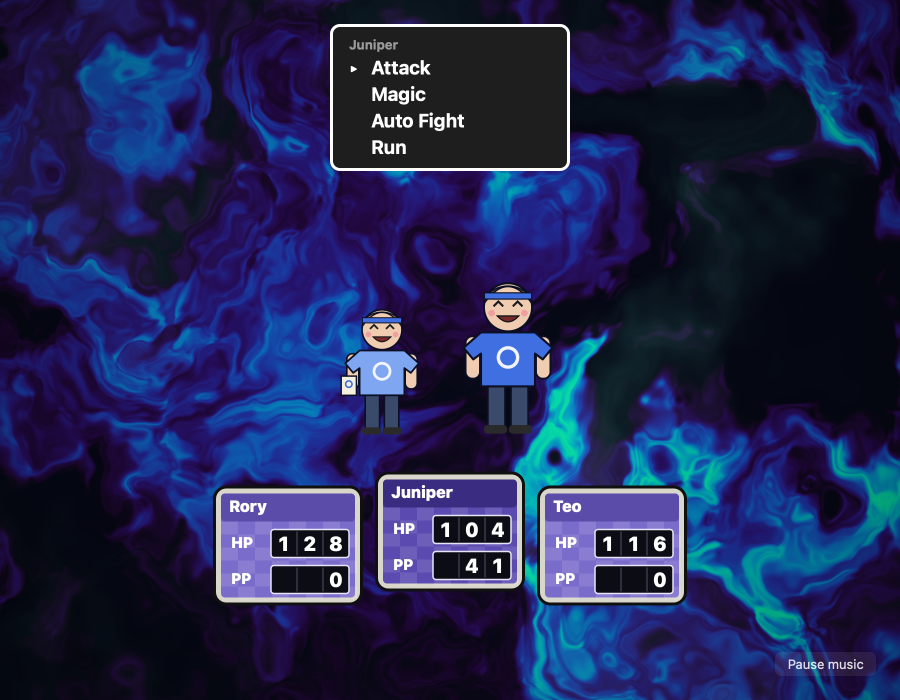

# Exactbound

A 16-bit-era RPG slice in the style of the SNES's suburban adventures. Walk Cheery Cheery
Village, talk to the villagers, and fight the Order of the Placid Blue in turn-based battles
over a swirling GPU aurora.





*The village gate · A Placid Acolyte says hello · A battle, Juniper choosing*

## Run it

From the repo root:

```sh
bun run exactbound          # build and open it
bun run test:exactbound     # its tests
```

Or from this folder: `bun exact.mjs mac --run`, and `bun exact.mjs test macos`.

The music and sound effects are not in this repo: the root scripts write silent stand-ins first
(`scripts/silent-audio.ts`). To hear the game, add your own files with the names in
[`assets/README.md`](assets/README.md). See the
[root README](../../README.md) for what a build needs.

## Controls

| Key | Action |
| --- | --- |
| Arrows or WASD | Walk (hold two keys to walk diagonally) |
| Space, Enter or Z | Talk, go on, choose |
| Escape or X | Back |
| Up / Down | Move through battle menus |
| Left / Right | Choose a target |

Every villager in a blue T-shirt starts a battle after they talk. Juniper has a Magic
menu (Fire and Heal). **Auto Fight** plays the battle for you; Escape or X takes the controls back.

## How it's made

- `app.contract`: the view and the game: the field, dialogue, the battle flow and its menus.
- `world.contract`: the village: a 44 × 34 tile map larger than the window (a camera follows
  you), its oblique SVG scenery, and the Order's members and what they say.
- `battle.contract`: the battle's rules as pure functions: the three heroes, the Order's foes,
  attacks and magic.
- `gpu/shaders/aurora.wgsl`: the battle background, a flowing aurora drawn on the GPU.
- `assets/`: the music and sound effects (not in git; see above).

The tests are in `app.test.contract` (8 of them); each builds the macOS app and drives it.
`CLAUDE.md` has notes for working on the game with Claude Code.
