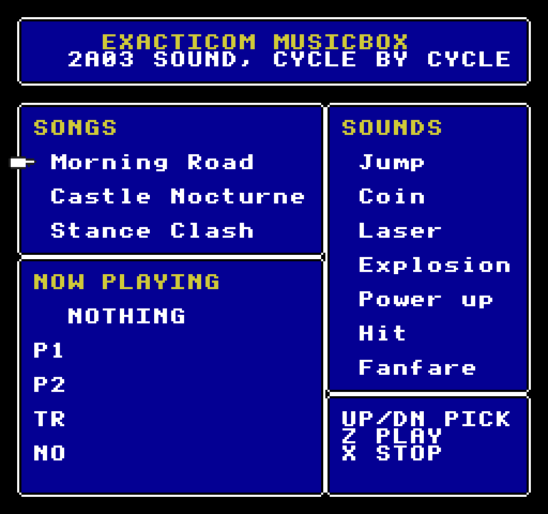
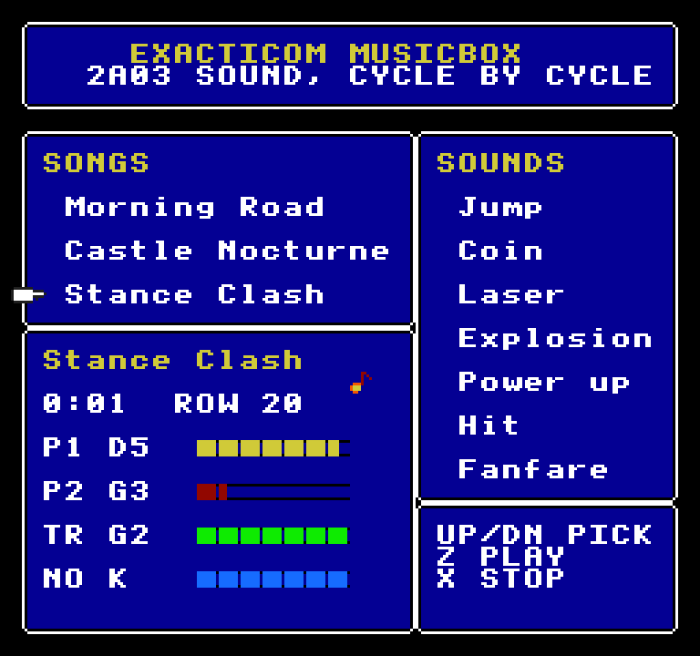

# Exacticom Musicbox

A jukebox for the [`nes-apu`](../../engines/nes-apu) engine: three original chiptunes and seven
sound effects, each made by the emulated NES sound chip, on a screen drawn by the NES picture
engine. While a song plays, each channel's meter follows the notes the sound driver wrote.




*The musicbox · Stance Clash playing: both pulses, the triangle and the noise drums*

## Run it

From the repo root:

```sh
bun run musicbox          # build and open it
bun run test:musicbox     # its tests
```

Or from this folder: `bun exact.mjs mac --run`, and `bun exact.mjs test macos`. See the
[root README](../../README.md) for what a build needs.

## Controls

| Key | Action |
| --- | --- |
| Up / Down | Choose a song or a sound |
| Z, Space or Enter | Play it |
| X or Escape | Stop the song |

## The music

| Song | Style |
| --- | --- |
| Morning Road | A bright overworld march in C: a 50% lead with vibrato, arpeggiated chords on a 25% pulse, a walking triangle bass, a kick, snare and hat kit on noise |
| Castle Nocturne | A minor-key castle theme in D: a thin 25% lead, an echoing counter-line, an eighth-note bass |
| Stance Clash | A fast battle theme in A minor: octave-jumping bass, 12.5% power-chord stabs |

The sound effects are register writes, frame by frame, the way game code made them, each showing
a part of the chip: **Jump** (the sweep unit, the length counter), **Coin** (the envelope's own
decay, retriggered), **Laser** (a downward sweep on a 12.5% pulse), **Explosion** (long-mode noise
from hiss to rumble), **Power up** (an arpeggio, volume set each frame), **Hit** (short, metallic
noise over a falling blip), **Fanfare** (both pulses and the triangle together).

## How it's made

- `gpu/src/music.rs`: the songs (tracker text and instruments for nes-apu's driver) and the
  sound effects (register writes).
- `gpu/src/lib.rs`: the screen, drawn by [`nes-ppu`](../../engines/nes-ppu) and shown by
  [`nes-screen`](../../engines/nes-screen): windows, text, meters and sprites in NES tiles.
  Its `render` test makes the audio: `cargo test --release -p exacticom-musicbox-gpu render -- --ignored`
  renders each song (two passes, for a seamless loop) and effect to `assets/music/` and
  `assets/sfx/`, and writes `songs.contract`, each song's notes and volumes by row.
- `app.contract`: the view: the list, the keys, the song's `audio` (looping), each effect's
  `playSound`, and the meters, which find the row from the time a song has played.

Exact plays declared audio files rather than samples made live, so the APU renders ahead of
time; the sound is the chip's all the same.

The tests are in `app.test.contract` (3 of them); each builds the macOS app and drives it.
`CLAUDE.md` has notes for working on it with Claude Code.
