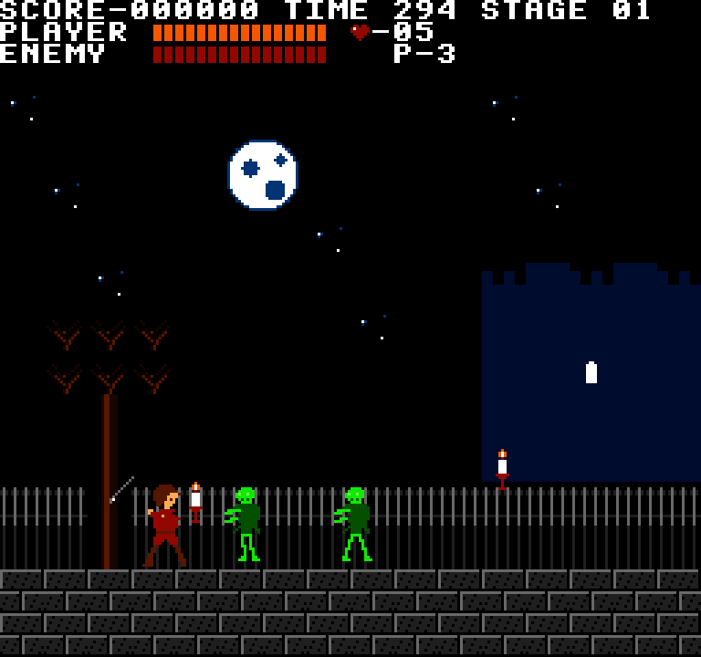
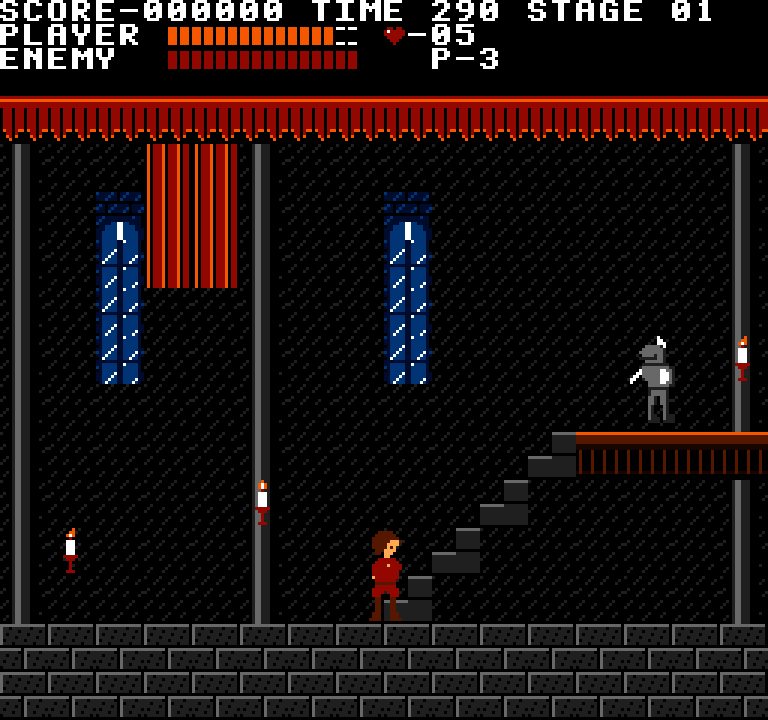
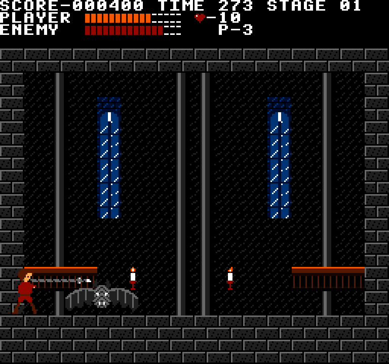

# Exactsylvania

A gothic action platformer in the style of the 8-bit castle crawlers, on the shared NES engine.
Vesper Holt and her chain whip cross the Gatehouse: a moonlit courtyard of rising ghouls, the
castle gate, an entrance hall of bats, knights, candles and stairs, and the Belfry, where the
Night Lord waits.





*The courtyard: a ghoul rises · The entrance hall, a knight on the balcony · The Night Lord swoops into the whip*

## Run it

From the repo root:

```sh
bun run exactsylvania          # build and open it
bun run test:exactsylvania     # its tests
```

Or from this folder: `bun exact.mjs mac --run`, and `bun exact.mjs test macos`. See the
[root README](../../README.md) for what a build needs.

## Controls

| Key | Action |
| --- | --- |
| Left / Right | Walk |
| Down | Crouch |
| Up | Climb a stair (at its foot); Down at its head goes down |
| Z, Space or K | Jump (a fixed arc: no steering in the air) |
| X or J | Whip; with Up held, throw the dagger (costs a heart) |
| Enter | Retry after Game Over, or replay after Stage Clear |

The whip winds back, then lashes out in front of you. It breaks candles, which drop hearts
(and one drops the dagger). Ghouls keep rising in the courtyard, bats wake as you pass, and
the knights take four lashes. Touching an enemy knocks you back and costs health; you flash
for two seconds after. Reach the door at the end of the hall before the time runs out. Behind it, in the Belfry,
the Night Lord sweeps the room and swoops down through where you stand: sixteen lashes clear
the stage. Die there and you start again in the Belfry.

## How it's made

- `app.contract`: the view and the game: Vesper's moves, the whip and dagger, enemies, candles,
  the door, the boss, and the HUD.
- `level.contract`: the map, stairs, candles, enemy posts and the boss's numbers.
- `gpu/src/lib.rs`: the scene the view describes, drawn by [`nes-ppu`](../../engines/nes-ppu) and
  shown by [`nes-screen`](../../engines/nes-screen), with `Limits::MODERN`: no sprite limits, so
  no flicker.
- `tools/level.py`: writes the map into both `level.contract` and `gpu/src/level.rs`.

## Sprite sheets

Exactsylvania is the example of drawing an NES-style game from PNG sprite sheets. Every
graphic comes from a sheet in [`assets/sprites/`](assets/sprites):

| Sheet | What is in it |
| --- | --- |
| `hero.png` | Vesper: stand, four walk frames, jump, crouch, whip poses, hurt (16×32 each) |
| `enemies.png` | the ghoul, knight and bat, two frames each |
| `boss.png` | the Night Lord, two wing frames (48×24) |
| `items.png` | the whip, the dagger, candles, hearts, the death flames |
| `tiles.png` | every background tile (16×16), 8 a row |
| `hud.png` | the health-bar cells, the heart and the dagger icon (8×8) |

[`gpu/src/sheets.rs`](gpu/src/sheets.rs) is the manifest: each frame's name, where it sits in its
sheet, its size, and its palette; each background tile's map character and palette. The build
embeds the sheets (`include_bytes!`) and turns each frame into NES tiles with nes-ppu's
`png::decode` and `Image::art` (`Image::bg_art` for background tiles), so a broken sheet fails
the build's tests.

To change a sprite:

1. Open its sheet in any paint program and draw in the frame's palette colours: the exact
   2C02 colours listed in `gpu/src/data.rs` (three for a sprite, plus transparency; four for a
   background tile). Other colours snap to the nearest of the palette's.
2. If you move a frame or add one, update its line in `sheets.rs` (and add it to `SPRITE_SHEETS`
   in `gpu/src/lib.rs` for a new sheet).
3. Rebuild: `bun exact.mjs mac` (or `cargo test -p exactsylvania-gpu` to check the sheets).

`tools/art.py` holds the starting art, drawn as text, and writes a sheet only when it is
missing (`--export` rewrites them all, over your edits). It also writes the palettes
(`gpu/src/data.rs`) and `tools/preview.png`.

The tests are in `app.test.contract` (7 of them); each builds the macOS app and drives it.
`CLAUDE.md` has notes for working on the game with Claude Code.
