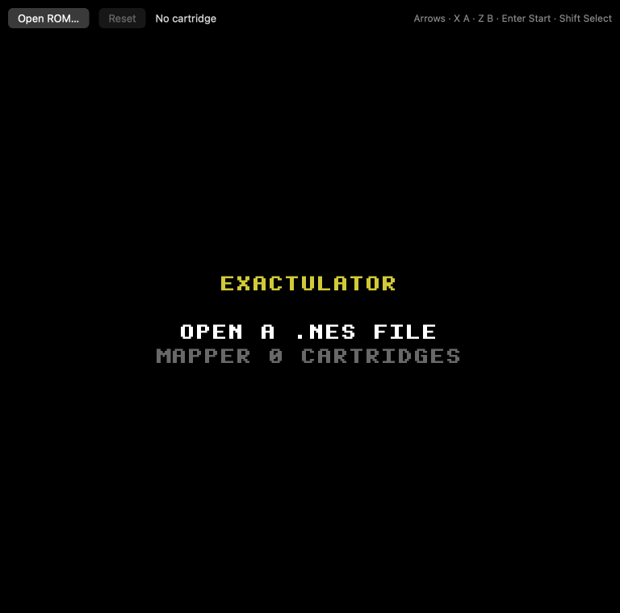
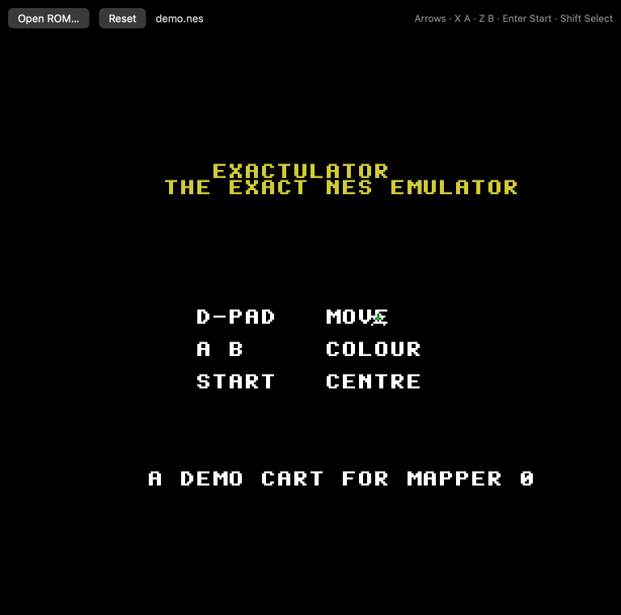
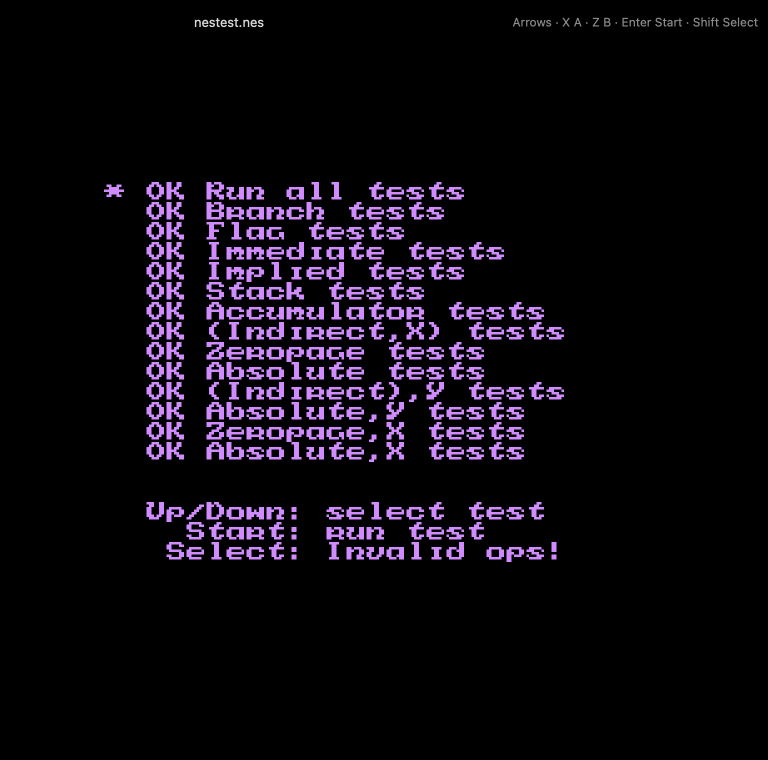

# Exactulator

A basic NES emulator. Open an iNES (`.nes`) file that uses mapper 0 (NROM) and play it. The
console is emulated by [`engines/nes-emu`](../../engines/nes-emu): the 6502, the PPU and the
controllers. Its picture is shown through [`nes-screen`](../../engines/nes-screen), at the NES's
own 60.0988 frames a second on any display. No sound yet.





*Before a cartridge · the demo cart · nestest after Start: every CPU test passes*

## Run it

From the repo root:

```sh
bun run exactulator          # build and open it
bun run test:exactulator     # its tests
```

Or from this folder: `bun exact.mjs mac --run`, and `bun exact.mjs test macos`. See the
[root README](../../README.md) for what a build needs.

## Play

Press **Open ROM…** and choose a `.nes` file. **Reset** presses the console's reset button.

| Key | NES button |
| --- | --- |
| Arrows | D-pad |
| X | A |
| Z | B |
| Enter | Start |
| Shift | Select |

`assets/demo.nes` is a small original cartridge made for this app: a title in the shared
font and a star the D-pad moves (A turns it green, B gold, Start centres it). It is assembled
by `tools/democart.py`, a two-pass 6502 assembler and the program's source in one file.

A ROM that is not iNES, or that needs another mapper, shows why on the screen instead.
Only use ROMs you have the right to: homebrew, test ROMs, or your own dumps.

## What is emulated

- **CPU**: the 2A03's 6502: every official opcode and the common unofficial ones (LAX, SAX,
  DCP, ISB, SLO, RLA, SRE, RRA, the extra NOPs), with cycle counts. It passes nestest's
  automated run to the cycle (`cargo test` in `engines/nes-emu`, with `NESTEST_ROM` set or
  `~/Downloads/nestest.nes`).
- **PPU**: registers `$2000`–`$2007`, name tables with the cartridge's mirroring, palettes,
  OAM and OAM DMA, vertical blank and its NMI, 8×8 and 8×16 sprites, 8 sprites a line, sprite-0
  hit, scroll changes between lines (split screens). It draws into nes-ppu's `Frame`, so the
  shared palette and screen show it.
- **Cartridge**: iNES, mapper 0: 16 or 32 KB of program, 8 KB of graphics ROM (or RAM), 8 KB
  of work RAM, horizontal or vertical mirroring.
- **Controllers**: two, through `$4016`/`$4017`; player 1 is the keyboard.

Not yet: sound (the APU's registers are taken and ignored; `engines/nes-apu` could play them,
once Exact can stream audio), other mappers, scroll changes in the middle of a line, and
the PPU's exact dot timing.

## How it's made

- `app.contract`: the view: the toolbar, the file picker, the keys as NES buttons, and the
  canvas the emulator draws.
- `app.ts`: reads the picked file and hands its bytes to the canvas as base64.
- `gpu/src/lib.rs`: the `ppu` surface: it loads the ROM into `nes_emu::Nes`, sets the held
  buttons, and runs as many NES frames as the clock owes before each draw.

The tests are in `app.test.contract` (2 of them: they open the demo cart through the real file
input and check the keys); `gpu/` has its own (`cargo test -p exactulator-gpu`), which run the
demo cart and move its star. `CLAUDE.md` has notes for working on it with Claude Code.
