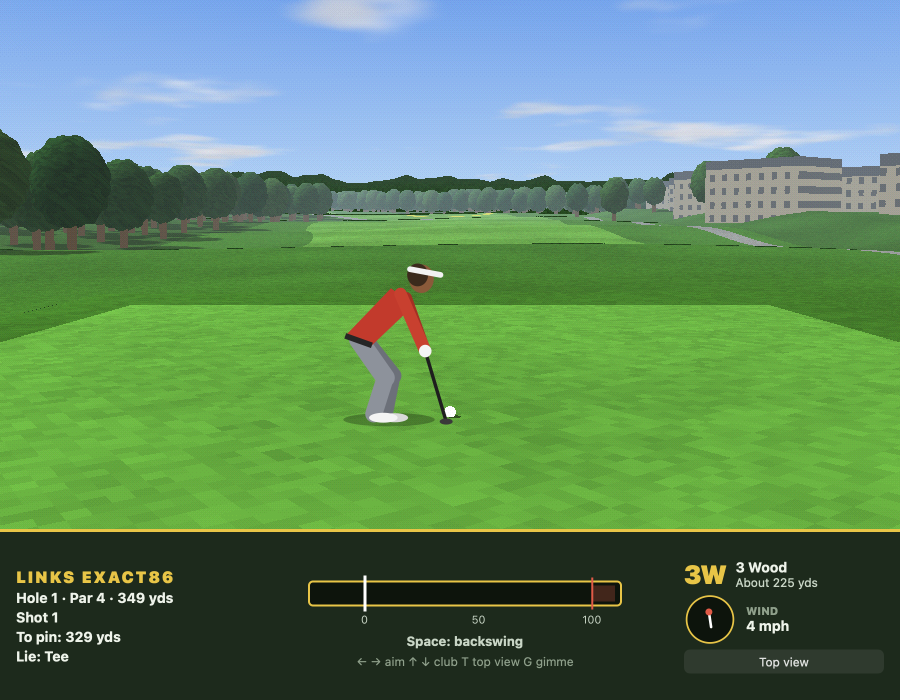
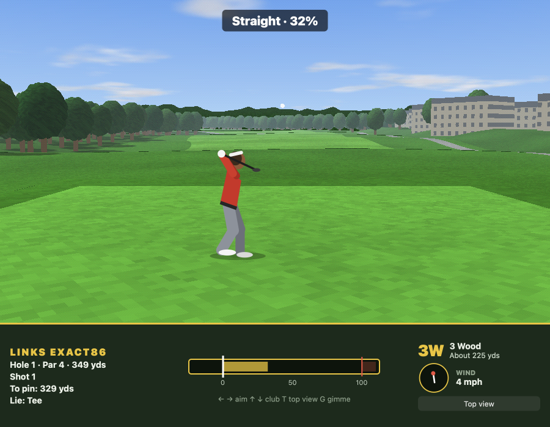
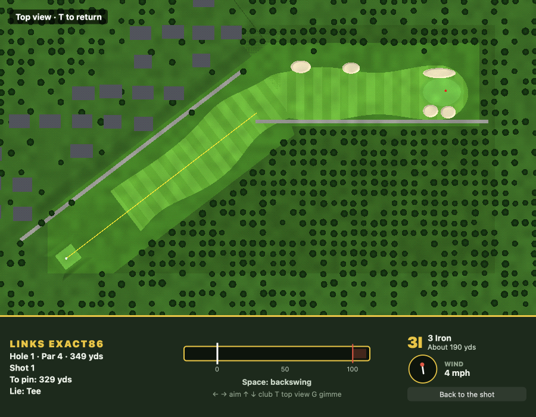

# Links Exact86

An early-90s PC golf game in the style of Links 386. Play hole 1, a dogleg-right par 4 laid
out after Pebble Beach's first, ray-marched from a fixed camera behind the ball, with the
classic three-press swing.





*On the tee with the 3 wood · The follow-through, the ball in flight · The top view, with the aim line*

## Run it

From the repo root:

```sh
bun run links          # build and open it
bun run test:links     # its tests
```

Or from this folder: `bun exact.mjs mac --run`, and `bun exact.mjs test macos`. See the
[root README](../../README.md) for what a build needs.

## Controls

| Key | Action |
| --- | --- |
| Left / Right | Aim |
| Up / Down | Change club |
| Space (3 times) | Start the backswing, set the power, then press at the white line for accuracy |
| T | Top view of the hole |
| G | Take a gimme (2 yards or less, on the green) |

An early third press hooks the ball and a late one slices it. Past 100% power, the accuracy
gets touchier.

## How it's made

- `app.contract`: the view and the round: clubs and aim, the three-press swing meter (power,
  accuracy, hook and slice), the ball's flight, and where it lands.
- `course.contract`: hole 1 in yards: its two legs, the green, the condos out of bounds, the
  trees in the dogleg, and the lie at any point (matching the shader).
- `golfer.contract`: the golfer, drawn down the line in profile, and the poses of its swing.
- `gpu/shaders/course.wgsl`: the course, ray-marched from the fixed camera behind the ball.

The tests are in `app.test.contract` (5 of them); each builds the macOS app and drives it.
`CLAUDE.md` has notes for working on the game with Claude Code.
